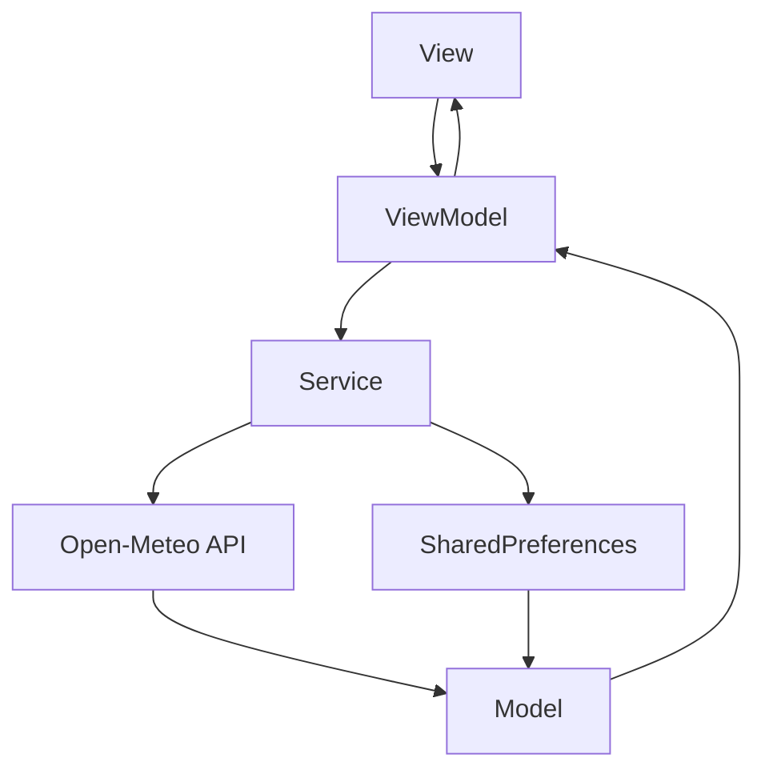

# Weatherly — Panduan Responsi Flutter Step 1–7

Versi Nothing Style: merah `#E52528`, hitam `#181818`, putih dan off-white `#F5F5F3`. Arsitektur MVVM, Provider, Open-Meteo dan SharedPreferences. Seluruh contoh kode tanpa komentar. Panduan ini menggabungkan tahapan sebelumnya dalam versi ringkas yang tetap memuat implementasi lengkap; beberapa layout disederhanakan tanpa mengubah fitur. Jalankan setiap tahap sebelum commit. Kode belum diuji pada perangkat Flutter.

## Step 1 — Inisialisasi project dan theme

```bash
flutter create weatherly
cd weatherly
flutter pub add provider http shared_preferences intl google_fonts
mkdir -p lib/{models,views,viewmodels,services,widgets,utils,themes}
touch lib/themes/app_theme.dart lib/views/{main_screen,weather_screen,search_screen}.dart lib/widgets/{dot_pattern,nothing_card,section_title}.dart
rm test/widget_test.dart
```

### `lib/themes/app_theme.dart`

```dart
import 'package:flutter/material.dart';
import 'package:google_fonts/google_fonts.dart';

class AppTheme {
  static const primary = Color(0xFFE52528);
  static const primaryLight = Color(0xFFFCE8E8);
  static const textPrimary = Color(0xFF181818);
  static const textSecondary = Color(0xFF737373);
  static const background = Color(0xFFF5F5F3);
  static const surface = Colors.white;
  static const border = Color(0xFFD4D4D4);

  static TextStyle dotText({double fontSize = 28, Color color = textPrimary}) =>
      GoogleFonts.dotGothic16(fontSize: fontSize, color: color, letterSpacing: 1.2);

  static ThemeData get lightTheme => ThemeData(
    useMaterial3: true,
    colorScheme: ColorScheme.fromSeed(seedColor: primary, primary: primary, surface: surface, onSurface: textPrimary),
    scaffoldBackgroundColor: background,
    textTheme: GoogleFonts.spaceGroteskTextTheme().apply(bodyColor: textPrimary, displayColor: textPrimary),
    appBarTheme: AppBarTheme(backgroundColor: background, foregroundColor: textPrimary, elevation: 0, scrolledUnderElevation: 0, titleTextStyle: dotText()),
    navigationBarTheme: const NavigationBarThemeData(backgroundColor: surface, indicatorColor: primaryLight, elevation: 0, height: 70),
    inputDecorationTheme: InputDecorationTheme(
      filled: true,
      fillColor: surface,
      border: OutlineInputBorder(borderRadius: BorderRadius.circular(30), borderSide: const BorderSide(color: textPrimary)),
      enabledBorder: OutlineInputBorder(borderRadius: BorderRadius.circular(30), borderSide: const BorderSide(color: textPrimary)),
      focusedBorder: OutlineInputBorder(borderRadius: BorderRadius.circular(30), borderSide: const BorderSide(color: primary, width: 1.5)),
    ),
    filledButtonTheme: FilledButtonThemeData(style: FilledButton.styleFrom(backgroundColor: primary, foregroundColor: Colors.white, shape: const StadiumBorder())),
    dividerTheme: const DividerThemeData(color: border),
  );
}
```

### `lib/widgets/dot_pattern.dart`

```dart
import 'package:flutter/material.dart';
import '../themes/app_theme.dart';

class DotPattern extends StatelessWidget {
  final double width, height, spacing, dotRadius;
  final Color color;
  const DotPattern({super.key, this.width = 100, this.height = 100, this.spacing = 12, this.dotRadius = 1, this.color = AppTheme.border});
  @override
  Widget build(BuildContext context) => CustomPaint(size: Size(width, height), painter: DotPatternPainter(spacing, dotRadius, color));
}

class DotPatternPainter extends CustomPainter {
  final double spacing, dotRadius;
  final Color color;
  const DotPatternPainter(this.spacing, this.dotRadius, this.color);
  @override
  void paint(Canvas canvas, Size size) {
    final paint = Paint()..color = color;
    for (double x = spacing / 2; x < size.width; x += spacing) {
      for (double y = spacing / 2; y < size.height; y += spacing) {
        canvas.drawCircle(Offset(x, y), dotRadius, paint);
      }
    }
  }
  @override
  bool shouldRepaint(covariant DotPatternPainter oldDelegate) => oldDelegate.spacing != spacing || oldDelegate.dotRadius != dotRadius || oldDelegate.color != color;
}
```

### `lib/widgets/nothing_card.dart`

```dart
import 'package:flutter/material.dart';
import '../themes/app_theme.dart';

class NothingCard extends StatelessWidget {
  final Widget child;
  final EdgeInsetsGeometry padding;
  final double radius, borderWidth;
  final Color backgroundColor, borderColor;
  const NothingCard({super.key, required this.child, this.padding = const EdgeInsets.all(16), this.radius = 22, this.backgroundColor = AppTheme.surface, this.borderColor = AppTheme.textPrimary, this.borderWidth = 1});
  @override
  Widget build(BuildContext context) => Container(width: double.infinity, padding: padding, decoration: BoxDecoration(color: backgroundColor, borderRadius: BorderRadius.circular(radius), border: Border.all(color: borderColor, width: borderWidth)), child: child);
}
```

### `lib/widgets/section_title.dart`

```dart
import 'package:flutter/material.dart';
import '../themes/app_theme.dart';

class SectionTitle extends StatelessWidget {
  final String title;
  final String? trailing;
  const SectionTitle({super.key, required this.title, this.trailing});
  @override
  Widget build(BuildContext context) => Row(children: [
    Container(width: 4, height: 18, color: AppTheme.primary),
    const SizedBox(width: 10),
    Expanded(child: Text(title.toUpperCase(), style: const TextStyle(fontSize: 14, fontWeight: FontWeight.w600, letterSpacing: 1.8))),
    if (trailing != null) Text(trailing!, style: const TextStyle(fontSize: 12, color: AppTheme.textSecondary)),
  ]);
}
```

### `lib/views/weather_screen.dart`

```dart
import 'package:flutter/material.dart';
import '../themes/app_theme.dart';
import '../widgets/nothing_card.dart';

class WeatherScreen extends StatelessWidget {
  const WeatherScreen({super.key});
  @override
  Widget build(BuildContext context) => Scaffold(
    appBar: AppBar(title: const Text('CUACA')),
    body: Center(child: Padding(padding: const EdgeInsets.all(24), child: NothingCard(child: Column(mainAxisSize: MainAxisSize.min, children: [
      const Icon(Icons.wb_cloudy_outlined, size: 80, color: AppTheme.primary),
      Text('WEATHERLY', style: AppTheme.dotText(fontSize: 32)),
      const Text('Informasi cuaca akan ditampilkan di sini', textAlign: TextAlign.center),
    ])))),
  );
}
```

### `lib/views/search_screen.dart`

```dart
import 'package:flutter/material.dart';
import '../widgets/nothing_card.dart';
import '../widgets/section_title.dart';

class SearchScreen extends StatelessWidget {
  const SearchScreen({super.key});
  @override
  Widget build(BuildContext context) => Scaffold(
    appBar: AppBar(title: const Text('CARI LOKASI')),
    body: ListView(padding: const EdgeInsets.all(20), children: const [
      TextField(decoration: InputDecoration(hintText: 'Cari nama kota...', prefixIcon: Icon(Icons.search))),
      SizedBox(height: 24),
      SectionTitle(title: 'Lokasi Favorit'),
      SizedBox(height: 16),
      NothingCard(child: Text('Belum ada favorit', textAlign: TextAlign.center)),
    ]),
  );
}
```

### `lib/views/main_screen.dart`

```dart
import 'package:flutter/material.dart';
import '../themes/app_theme.dart';
import 'weather_screen.dart';
import 'search_screen.dart';

class MainScreen extends StatefulWidget {
  const MainScreen({super.key});
  @override
  State<MainScreen> createState() => _MainScreenState();
}

class _MainScreenState extends State<MainScreen> {
  int _selectedIndex = 0;
  @override
  Widget build(BuildContext context) => Scaffold(
    body: IndexedStack(index: _selectedIndex, children: const [WeatherScreen(), SearchScreen()]),
    bottomNavigationBar: Container(
      decoration: const BoxDecoration(border: Border(top: BorderSide(color: AppTheme.textPrimary))),
      child: NavigationBar(selectedIndex: _selectedIndex, onDestinationSelected: (index) {
        FocusScope.of(context).unfocus();
        setState(() => _selectedIndex = index);
      }, destinations: const [
        NavigationDestination(icon: Icon(Icons.wb_cloudy_outlined), selectedIcon: Icon(Icons.wb_cloudy, color: AppTheme.primary), label: 'Cuaca'),
        NavigationDestination(icon: Icon(Icons.search), selectedIcon: Icon(Icons.search, color: AppTheme.primary), label: 'Cari Lokasi'),
      ]),
    ),
  );
}
```

### `lib/main.dart`

```dart
import 'package:flutter/material.dart';
import 'package:flutter/services.dart';
import 'themes/app_theme.dart';
import 'views/main_screen.dart';

void main() {
  WidgetsFlutterBinding.ensureInitialized();
  SystemChrome.setSystemUIOverlayStyle(const SystemUiOverlayStyle(statusBarColor: Colors.transparent, statusBarIconBrightness: Brightness.dark, systemNavigationBarColor: AppTheme.surface, systemNavigationBarIconBrightness: Brightness.dark));
  runApp(const WeatherlyApp());
}

class WeatherlyApp extends StatelessWidget {
  const WeatherlyApp({super.key});
  @override
  Widget build(BuildContext context) => MaterialApp(title: 'Weatherly', debugShowCheckedModeBanner: false, theme: AppTheme.lightTheme, home: const MainScreen());
}
```

Tambahkan sebelum tag `application` pada `android/app/src/main/AndroidManifest.xml`:

```xml
<uses-permission android:name="android.permission.INTERNET" />
```

Ubah atribut `android:label` menjadi `Weatherly`.

```bash
dart format lib
flutter analyze
flutter run
git init
git add .
git commit -m "Initial project setup with Nothing style theme"
git branch -M main
git remote add origin https://github.com/USERNAME/weatherly-nothing.git
git push -u origin main
```

Buat repository kosong terlebih dahulu dan ganti USERNAME. Jika remote sudah ada, jangan menambahkannya lagi.

## Step 2 — Model dan Open-Meteo API

```bash
touch lib/models/{location_model,forecast_model,weather_model}.dart lib/services/{geocoding_service,weather_service}.dart
```

### `lib/models/location_model.dart`

```dart
class LocationModel {
  final int id;
  final String name, country, admin1;
  final double latitude, longitude;
  const LocationModel({required this.id, required this.name, required this.country, required this.admin1, required this.latitude, required this.longitude});
  factory LocationModel.fromJson(Map<String, dynamic> json) => LocationModel(
    id: (json['id'] as num).toInt(),
    name: json['name'] as String,
    country: json['country'] as String? ?? '',
    admin1: json['admin1'] as String? ?? '',
    latitude: (json['latitude'] as num).toDouble(),
    longitude: (json['longitude'] as num).toDouble(),
  );
  Map<String, dynamic> toJson() => {'id': id, 'name': name, 'country': country, 'admin1': admin1, 'latitude': latitude, 'longitude': longitude};
  String get fullAddress => [admin1, country].where((value) => value.isNotEmpty).join(', ');
}
```

### `lib/models/forecast_model.dart`

```dart
class ForecastModel {
  final DateTime date;
  final double temperatureMax, temperatureMin;
  final int precipitationProbability, weatherCode;
  const ForecastModel({required this.date, required this.temperatureMax, required this.temperatureMin, required this.precipitationProbability, required this.weatherCode});
  factory ForecastModel.fromJson(Map<String, dynamic> json, int index) => ForecastModel(
    date: DateTime.parse(json['time'][index]),
    temperatureMax: (json['temperature_2m_max'][index] as num).toDouble(),
    temperatureMin: (json['temperature_2m_min'][index] as num).toDouble(),
    precipitationProbability: (json['precipitation_probability_max'][index] as num).toInt(),
    weatherCode: (json['weather_code'][index] as num).toInt(),
  );
}
```

### `lib/models/weather_model.dart`

```dart
import 'forecast_model.dart';

class WeatherModel {
  final double temperature, apparentTemperature, precipitation, windSpeed;
  final int humidity, weatherCode;
  final List<ForecastModel> forecasts;
  const WeatherModel({required this.temperature, required this.apparentTemperature, required this.humidity, required this.precipitation, required this.weatherCode, required this.windSpeed, required this.forecasts});
  factory WeatherModel.fromJson(Map<String, dynamic> json) {
    final current = json['current'] as Map<String, dynamic>;
    final daily = json['daily'] as Map<String, dynamic>;
    final dates = daily['time'] as List<dynamic>;
    return WeatherModel(
      temperature: (current['temperature_2m'] as num).toDouble(),
      apparentTemperature: (current['apparent_temperature'] as num).toDouble(),
      humidity: (current['relative_humidity_2m'] as num).toInt(),
      precipitation: (current['precipitation'] as num).toDouble(),
      weatherCode: (current['weather_code'] as num).toInt(),
      windSpeed: (current['wind_speed_10m'] as num).toDouble(),
      forecasts: List.generate(dates.length, (index) => ForecastModel.fromJson(daily, index)),
    );
  }
}
```

### `lib/services/geocoding_service.dart`

```dart
import 'dart:convert';
import 'package:http/http.dart' as http;
import '../models/location_model.dart';

class GeocodingService {
  Future<List<LocationModel>> searchLocation(String query) async {
    if (query.trim().length < 2) return [];
    final uri = Uri.https('geocoding-api.open-meteo.com', '/v1/search', {'name': query.trim(), 'count': '10', 'language': 'id', 'format': 'json'});
    final response = await http.get(uri).timeout(const Duration(seconds: 15));
    if (response.statusCode != 200) throw Exception('Gagal mencari lokasi');
    final data = jsonDecode(response.body) as Map<String, dynamic>;
    final results = data['results'] as List<dynamic>? ?? [];
    return results.map((item) => LocationModel.fromJson(item as Map<String, dynamic>)).toList();
  }
}
```

### `lib/services/weather_service.dart`

```dart
import 'dart:convert';
import 'package:http/http.dart' as http;
import '../models/weather_model.dart';

class WeatherService {
  Future<WeatherModel> getWeather(double latitude, double longitude) async {
    final uri = Uri.https('api.open-meteo.com', '/v1/forecast', {
      'latitude': latitude.toString(), 'longitude': longitude.toString(),
      'current': 'temperature_2m,relative_humidity_2m,apparent_temperature,precipitation,weather_code,wind_speed_10m',
      'daily': 'temperature_2m_max,temperature_2m_min,precipitation_probability_max,weather_code',
      'timezone': 'auto', 'forecast_days': '5',
    });
    final response = await http.get(uri).timeout(const Duration(seconds: 15));
    if (response.statusCode != 200) throw Exception('Gagal mengambil data cuaca');
    return WeatherModel.fromJson(jsonDecode(response.body) as Map<String, dynamic>);
  }
}
```

Dokumentasi: https://open-meteo.com/en/docs dan https://open-meteo.com/en/docs/geocoding-api. Uji endpoint melalui browser. Tampilan masih sama dengan step 1.

```bash
dart format lib
flutter analyze
git add .
git commit -m "Implement data models and Open-Meteo API services"
git push origin main
```

## Step 3 — Weather ViewModel dan state management

```bash
touch lib/viewmodels/weather_viewmodel.dart lib/utils/weather_helper.dart lib/widgets/weather_state.dart
```

### `lib/viewmodels/weather_viewmodel.dart`

```dart
import 'package:flutter/material.dart';
import '../models/location_model.dart';
import '../models/weather_model.dart';
import '../services/weather_service.dart';
import '../services/geocoding_service.dart';

class WeatherViewModel extends ChangeNotifier {
  final _weatherService = WeatherService();
  final _geocodingService = GeocodingService();
  LocationModel? _selectedLocation;
  WeatherModel? _weather;
  bool _isLoading = false, _disposed = false;
  String? _errorMessage;
  int _requestId = 0;
  LocationModel? get selectedLocation => _selectedLocation;
  WeatherModel? get weather => _weather;
  bool get isLoading => _isLoading;
  String? get errorMessage => _errorMessage;
  Future<void> initialize() async {
    final requestId = ++_requestId;
    _isLoading = true;
    _errorMessage = null;
    _weather = null;
    notifyListeners();
    try {
      final locations = await _geocodingService.searchLocation('Yogyakarta');
      if (_disposed || requestId != _requestId) return;
      if (locations.isEmpty) { _selectedLocation = null; return; }
      _selectedLocation = locations.first;
      final result = await _weatherService.getWeather(_selectedLocation!.latitude, _selectedLocation!.longitude);
      if (_disposed || requestId != _requestId) return;
      _weather = result;
    } catch (e) {
      if (!_disposed && requestId == _requestId) _errorMessage = 'Gagal memuat data cuaca';
    } finally {
      if (!_disposed && requestId == _requestId) { _isLoading = false; notifyListeners(); }
    }
  }
  Future<void> selectLocation(LocationModel location) async {
    _selectedLocation = location;
    await fetchWeather();
  }
  Future<void> fetchWeather() async {
    final location = _selectedLocation;
    if (location == null) return;
    final requestId = ++_requestId;
    _isLoading = true;
    _errorMessage = null;
    _weather = null;
    notifyListeners();
    try {
      final result = await _weatherService.getWeather(location.latitude, location.longitude);
      if (_disposed || requestId != _requestId) return;
      _weather = result;
    } catch (e) {
      if (!_disposed && requestId == _requestId) _errorMessage = 'Gagal memuat data cuaca';
    } finally {
      if (!_disposed && requestId == _requestId) { _isLoading = false; notifyListeners(); }
    }
  }
  Future<void> refreshWeather() async {
    if (_isLoading) return;
    if (_selectedLocation == null) { await initialize(); } else { await fetchWeather(); }
  }
  @override
  void dispose() { _disposed = true; super.dispose(); }
}
```

### `lib/utils/weather_helper.dart`

```dart
import 'package:flutter/material.dart';

class WeatherHelper {
  static String getDescription(int code) {
    switch (code) {
      case 0: return 'Cerah';
      case 1: return 'Cerah Berawan';
      case 2: return 'Berawan Sebagian';
      case 3: return 'Berawan';
      case 45: case 48: return 'Berkabut';
      case 51: case 53: case 55: return 'Gerimis';
      case 56: case 57: return 'Gerimis Beku';
      case 61: return 'Hujan Ringan';
      case 63: return 'Hujan Sedang';
      case 65: return 'Hujan Lebat';
      case 66: case 67: return 'Hujan Beku';
      case 71: case 73: case 75: case 77: return 'Salju';
      case 80: return 'Hujan Lokal Ringan';
      case 81: return 'Hujan Lokal Sedang';
      case 82: return 'Hujan Lokal Lebat';
      case 85: case 86: return 'Hujan Salju';
      case 95: case 96: case 99: return 'Badai Petir';
      default: return 'Tidak Diketahui';
    }
  }
  static IconData getIcon(int code) {
    if (code == 0) return Icons.wb_sunny_outlined;
    if ([1,2,3].contains(code)) return Icons.cloud_outlined;
    if ([45,48].contains(code)) return Icons.foggy;
    if ([51,53,55,56,57].contains(code)) return Icons.grain_rounded;
    if ([61,63,65,66,67,80,81,82].contains(code)) return Icons.water_drop_outlined;
    if ([71,73,75,77,85,86].contains(code)) return Icons.ac_unit_rounded;
    if ([95,96,99].contains(code)) return Icons.thunderstorm_outlined;
    return Icons.cloud_off_outlined;
  }
}
```

### `lib/widgets/weather_state.dart`

```dart
import 'package:flutter/material.dart';
import '../themes/app_theme.dart';
import 'nothing_card.dart';
import 'dot_pattern.dart';

class WeatherState extends StatelessWidget {
  final IconData icon;
  final String title, message;
  final String? buttonText;
  final VoidCallback? onPressed;
  final bool isLoading;
  const WeatherState({super.key, required this.icon, required this.title, required this.message, this.buttonText, this.onPressed, this.isLoading = false});
  @override
  Widget build(BuildContext context) => Center(child: SingleChildScrollView(
    padding: const EdgeInsets.all(24),
    child: ConstrainedBox(constraints: const BoxConstraints(maxWidth: 420), child: Stack(children: [
      NothingCard(padding: const EdgeInsets.all(28), radius: 28, child: Column(mainAxisSize: MainAxisSize.min, children: [
        if (isLoading) const CircularProgressIndicator(color: AppTheme.primary) else Icon(icon, size: 48, color: AppTheme.primary),
        const SizedBox(height: 24),
        Text(title.toUpperCase(), style: AppTheme.dotText(fontSize: 22), textAlign: TextAlign.center),
        const SizedBox(height: 10),
        Text(message, textAlign: TextAlign.center, style: const TextStyle(color: AppTheme.textSecondary)),
        if (buttonText != null && onPressed != null) ...[const SizedBox(height: 24), FilledButton(onPressed: onPressed, child: Text(buttonText!))],
      ])),
      const Positioned(top: 12, right: 12, child: IgnorePointer(child: DotPattern(width: 40, height: 40, spacing: 8))),
    ])),
  ));
}
```

### `lib/main.dart` (ganti seluruh file)

```dart
import 'package:flutter/material.dart';
import 'package:flutter/services.dart';
import 'package:provider/provider.dart';
import 'package:intl/date_symbol_data_local.dart';
import 'themes/app_theme.dart';
import 'views/main_screen.dart';
import 'viewmodels/weather_viewmodel.dart';

Future<void> main() async {
  WidgetsFlutterBinding.ensureInitialized();
  await initializeDateFormatting('id_ID');
  SystemChrome.setSystemUIOverlayStyle(const SystemUiOverlayStyle(statusBarColor: Colors.transparent, statusBarIconBrightness: Brightness.dark, systemNavigationBarColor: AppTheme.surface, systemNavigationBarIconBrightness: Brightness.dark));
  runApp(MultiProvider(providers: [ChangeNotifierProvider(create: (_) => WeatherViewModel()..initialize())], child: const WeatherlyApp()));
}

class WeatherlyApp extends StatelessWidget {
  const WeatherlyApp({super.key});
  @override
  Widget build(BuildContext context) => MaterialApp(title: 'Weatherly', debugShowCheckedModeBanner: false, theme: AppTheme.lightTheme, home: const MainScreen());
}
```

### `lib/views/weather_screen.dart` (ganti seluruh file)

```dart
import 'package:flutter/material.dart';
import 'package:provider/provider.dart';
import '../themes/app_theme.dart';
import '../viewmodels/weather_viewmodel.dart';
import '../utils/weather_helper.dart';
import '../widgets/nothing_card.dart';
import '../widgets/weather_state.dart';

class WeatherScreen extends StatelessWidget {
  const WeatherScreen({super.key});
  @override
  Widget build(BuildContext context) => Consumer<WeatherViewModel>(builder: (context, vm, child) => Scaffold(
    appBar: AppBar(title: const Text('CUACA'), actions: [IconButton(onPressed: vm.isLoading ? null : vm.refreshWeather, icon: const Icon(Icons.refresh))]),
    body: _body(vm),
  ));
  Widget _body(WeatherViewModel vm) {
    if (vm.isLoading) return const WeatherState(icon: Icons.cloud_outlined, title: 'Memuat data', message: 'Mengambil informasi cuaca', isLoading: true);
    if (vm.errorMessage != null) return WeatherState(icon: Icons.wifi_off, title: vm.errorMessage!, message: 'Periksa koneksi internet', buttonText: 'Coba Lagi', onPressed: vm.refreshWeather);
    final weather = vm.weather;
    final location = vm.selectedLocation;
    if (weather == null || location == null) return WeatherState(icon: Icons.cloud_off_outlined, title: 'Data tidak ditemukan', message: 'Belum ada informasi cuaca', buttonText: 'Muat Ulang', onPressed: vm.refreshWeather);
    return RefreshIndicator(onRefresh: vm.refreshWeather, child: ListView(physics: const AlwaysScrollableScrollPhysics(), padding: const EdgeInsets.all(20), children: [
      Text(location.name, style: const TextStyle(fontSize: 22, fontWeight: FontWeight.bold)),
      Text(location.fullAddress),
      const SizedBox(height: 20),
      NothingCard(child: Column(children: [
        Icon(WeatherHelper.getIcon(weather.weatherCode), size: 90, color: AppTheme.primary),
        Text('${weather.temperature.round()}°C', style: AppTheme.dotText(fontSize: 54)),
        Text(WeatherHelper.getDescription(weather.weatherCode)),
        Text('Terasa seperti ${weather.apparentTemperature.round()}°C'),
      ])),
      const SizedBox(height: 20),
      NothingCard(child: Column(children: [
        ListTile(title: const Text('Kelembapan'), trailing: Text('${weather.humidity}%')),
        ListTile(title: const Text('Angin'), trailing: Text('${weather.windSpeed} km/j')),
        ListTile(title: const Text('Curah Hujan'), trailing: Text('${weather.precipitation} mm')),
      ])),
    ]));
  }
}
```

Uji loading, cuaca Yogyakarta, refresh, dan error saat internet mati.

```bash
dart format lib
flutter analyze
flutter run
git add .
git commit -m "Implement weather ViewModel and state management"
git push origin main
```

## Step 4 — Nothing Style Weather Screen

```bash
touch lib/widgets/{dot_weather_icon,current_weather_card,weather_detail_card,forecast_card}.dart
```

### `lib/widgets/dot_weather_icon.dart`

```dart
import 'dart:math' as math;
import 'package:flutter/material.dart';
import '../themes/app_theme.dart';

class DotWeatherIcon extends StatelessWidget {
  final int weatherCode;
  final double size;
  final Color color, accentColor;
  const DotWeatherIcon({super.key, required this.weatherCode, this.size = 100, this.color = AppTheme.textPrimary, this.accentColor = AppTheme.primary});
  @override
  Widget build(BuildContext context) => CustomPaint(size: Size(size, size), painter: DotWeatherPainter(weatherCode, color, accentColor));
}

class DotWeatherPainter extends CustomPainter {
  final int weatherCode;
  final Color color, accentColor;
  const DotWeatherPainter(this.weatherCode, this.color, this.accentColor);
  void _dots(Canvas canvas, Path path, Color color, {double spacing = 4, double radius = 1.6}) {
    final paint = Paint()..color = color;
    for (double x = 2; x < 100; x += spacing) {
      for (double y = 2; y < 100; y += spacing) {
        final point = Offset(x, y);
        if (path.contains(point)) canvas.drawCircle(point, radius, paint);
      }
    }
  }
  Path _cloud(double top) => Path()..moveTo(24, top + 42)..cubicTo(2, top + 42, 2, top + 13, 24, top + 13)..cubicTo(29, top - 9, 58, top - 9, 68, top + 13)..cubicTo(95, top + 8, 99, top + 42, 76, top + 42)..close();
  @override
  void paint(Canvas canvas, Size size) {
    canvas.save();
    final scale = size.shortestSide / 100;
    canvas.translate((size.width - 100 * scale) / 2, (size.height - 100 * scale) / 2);
    canvas.scale(scale);
    canvas.saveLayer(const Rect.fromLTWH(0, 0, 100, 100), Paint());
    final accent = Paint()..color = accentColor;
    final ink = Paint()..color = color;
    if (weatherCode == 0 || [1, 2].contains(weatherCode)) {
      final center = weatherCode == 0 ? const Offset(50, 50) : const Offset(67, 30);
      final radius = weatherCode == 0 ? 24.0 : 19.0;
      _dots(canvas, Path()..addOval(Rect.fromCircle(center: center, radius: radius)), accentColor);
      if (weatherCode == 0) {
        for (int i = 0; i < 8; i++) {
          final angle = i * math.pi / 4;
          for (double d = 31; d <= 41; d += 5) {
            canvas.drawCircle(Offset(50 + math.cos(angle) * d, 50 + math.sin(angle) * d), 1.9, accent);
          }
        }
      }
    }
    if (weatherCode != 0) {
      final partly = [1, 2].contains(weatherCode);
      final path = _cloud(partly ? 30 : weatherCode == 3 ? 22 : 10);
      if (partly) canvas.drawPath(path, Paint()..blendMode = BlendMode.clear);
      for (final metric in path.computeMetrics()) {
        for (double d = 0; d < metric.length; d += 4) {
          final tangent = metric.getTangentForOffset(d);
          if (tangent != null) canvas.drawCircle(tangent.position, 1.8, ink);
        }
      }
      _dots(canvas, path, color.withValues(alpha: 0.18), spacing: 6, radius: 0.7);
      if ([45, 48].contains(weatherCode)) {
        for (int row = 0; row < 3; row++) {
          for (double x = 15; x <= 85; x += 5) {
            canvas.drawCircle(Offset(x, 64.0 + row * 9), 1.6, ink);
          }
        }
      } else if ([51,53,55,56,57,61,63,65,66,67,80,81,82].contains(weatherCode)) {
        final count = [51,53,55,56,57].contains(weatherCode) ? 3 : 4;
        for (int i = 0; i < count; i++) {
          for (int j = 0; j < 4; j++) {
            canvas.drawCircle(Offset(26.0 + i * 15 - j * 2, 63.0 + j * 5), 1.7, accent);
          }
        }
      } else if ([71,73,75,77,85,86].contains(weatherCode)) {
        for (int i = 0; i < 3; i++) {
          final center = Offset(25.0 + i * 25, 72);
          canvas.drawCircle(center, 2, accent);
          for (int j = 0; j < 6; j++) {
            final angle = j * math.pi / 3;
            canvas.drawCircle(Offset(center.dx + math.cos(angle) * 5, center.dy + math.sin(angle) * 5), 1.6, accent);
          }
        }
      } else if ([95,96,99].contains(weatherCode)) {
        final bolt = Path()..moveTo(49, 56)..lineTo(65, 56)..lineTo(53, 72)..lineTo(65, 72)..lineTo(37, 97)..lineTo(46, 78)..lineTo(35, 78)..close();
        _dots(canvas, bolt, accentColor, spacing: 3, radius: 1.3);
      }
    }
    canvas.restore();
    canvas.restore();
  }
  @override
  bool shouldRepaint(covariant DotWeatherPainter oldDelegate) => oldDelegate.weatherCode != weatherCode || oldDelegate.color != color || oldDelegate.accentColor != accentColor;
}
```

Layer `saveLayer` sudah disertakan agar `BlendMode.clear` tidak menghapus background kartu.

### `lib/widgets/current_weather_card.dart`

```dart
import 'package:flutter/material.dart';
import '../models/weather_model.dart';
import '../themes/app_theme.dart';
import '../utils/weather_helper.dart';
import 'dot_weather_icon.dart';
import 'nothing_card.dart';

class CurrentWeatherCard extends StatelessWidget {
  final WeatherModel weather;
  const CurrentWeatherCard({super.key, required this.weather});
  @override
  Widget build(BuildContext context) {
    final today = weather.forecasts.isNotEmpty ? weather.forecasts.first : null;
    return NothingCard(radius: 28, padding: const EdgeInsets.all(20), child: LayoutBuilder(builder: (context, constraints) {
      final compact = constraints.maxWidth < 260;
      final icon = DotWeatherIcon(weatherCode: weather.weatherCode, size: compact ? 100 : 112);
      final info = Column(crossAxisAlignment: compact ? CrossAxisAlignment.center : CrossAxisAlignment.start, children: [
        FittedBox(fit: BoxFit.scaleDown, child: Text('${weather.temperature.round()}°C', style: AppTheme.dotText(fontSize: 54))),
        Text(WeatherHelper.getDescription(weather.weatherCode), style: const TextStyle(fontSize: 16, fontWeight: FontWeight.w600)),
        const SizedBox(height: 4),
        Text('Terasa seperti ${weather.apparentTemperature.round()}°C', style: const TextStyle(fontSize: 12, color: AppTheme.textSecondary)),
      ]);
      return Column(children: [
        if (compact) Column(children: [icon, const SizedBox(height: 8), info]) else Row(children: [icon, Container(width: 1, height: 100, margin: const EdgeInsets.symmetric(horizontal: 14), color: AppTheme.border), Expanded(child: info)]),
        if (today != null) ...[
          const SizedBox(height: 20),
          Container(padding: const EdgeInsets.symmetric(horizontal: 16, vertical: 10), decoration: BoxDecoration(color: AppTheme.background, borderRadius: BorderRadius.circular(30), border: Border.all(color: AppTheme.border)), child: Row(mainAxisAlignment: MainAxisAlignment.center, children: [
            const Icon(Icons.arrow_upward_rounded, color: AppTheme.primary, size: 18),
            Text('${today.temperatureMax.round()}°C'),
            const SizedBox(width: 20),
            const Icon(Icons.arrow_downward_rounded, color: AppTheme.textSecondary, size: 18),
            Text('${today.temperatureMin.round()}°C'),
          ])),
        ],
      ]);
    }));
  }
}
```

### `lib/widgets/weather_detail_card.dart`

```dart
import 'package:flutter/material.dart';
import '../themes/app_theme.dart';
import 'nothing_card.dart';

class WeatherDetailCard extends StatelessWidget {
  final String title, value;
  final IconData icon;
  const WeatherDetailCard({super.key, required this.title, required this.value, required this.icon});
  @override
  Widget build(BuildContext context) => NothingCard(radius: 18, padding: const EdgeInsets.all(14), child: Column(crossAxisAlignment: CrossAxisAlignment.start, mainAxisAlignment: MainAxisAlignment.center, children: [
    Row(children: [Icon(icon, color: AppTheme.primary, size: 22), const SizedBox(width: 8), Expanded(child: Text(title, maxLines: 2, overflow: TextOverflow.ellipsis, style: const TextStyle(fontSize: 11, color: AppTheme.textSecondary)))]),
    const SizedBox(height: 12),
    FittedBox(fit: BoxFit.scaleDown, alignment: Alignment.centerLeft, child: Text(value, style: AppTheme.dotText(fontSize: 26))),
  ]));
}
```

### `lib/widgets/forecast_card.dart`

```dart
import 'package:flutter/material.dart';
import 'package:intl/intl.dart';
import '../models/forecast_model.dart';
import '../themes/app_theme.dart';
import '../utils/weather_helper.dart';
import 'dot_weather_icon.dart';
import 'nothing_card.dart';

class ForecastCard extends StatelessWidget {
  final ForecastModel forecast;
  final bool isToday;
  const ForecastCard({super.key, required this.forecast, this.isToday = false});
  @override
  Widget build(BuildContext context) {
    final color = isToday ? Colors.white : AppTheme.textPrimary;
    final secondary = isToday ? Colors.white70 : AppTheme.textSecondary;
    return SizedBox(width: 88, child: NothingCard(radius: 18, padding: const EdgeInsets.symmetric(horizontal: 8, vertical: 14), backgroundColor: isToday ? AppTheme.primary : AppTheme.surface, borderColor: isToday ? AppTheme.primary : AppTheme.textPrimary, child: Column(mainAxisSize: MainAxisSize.min, children: [
      Text(isToday ? 'Hari ini' : DateFormat('EEE', 'id_ID').format(forecast.date), style: TextStyle(fontSize: 12, fontWeight: FontWeight.w600, color: color)),
      Text(DateFormat('dd MMM', 'id_ID').format(forecast.date), style: TextStyle(fontSize: 10, color: secondary)),
      const SizedBox(height: 8),
      DotWeatherIcon(weatherCode: forecast.weatherCode, size: 48, color: color, accentColor: isToday ? Colors.white : AppTheme.primary),
      const SizedBox(height: 6),
      Tooltip(message: WeatherHelper.getDescription(forecast.weatherCode), child: FittedBox(child: Text('${forecast.temperatureMax.round()}°/${forecast.temperatureMin.round()}°', style: TextStyle(color: color, fontWeight: FontWeight.w600)))),
      const SizedBox(height: 10),
      Row(mainAxisAlignment: MainAxisAlignment.center, children: [Icon(Icons.water_drop_outlined, size: 12, color: isToday ? Colors.white : AppTheme.primary), const SizedBox(width: 3), Text('${forecast.precipitationProbability}%', style: TextStyle(fontSize: 11, color: color))]),
    ])));
  }
}
```

### `lib/views/weather_screen.dart` (ganti seluruh file)

```dart
import 'package:flutter/material.dart';
import 'package:provider/provider.dart';
import '../themes/app_theme.dart';
import '../viewmodels/weather_viewmodel.dart';
import '../widgets/dot_pattern.dart';
import '../widgets/current_weather_card.dart';
import '../widgets/weather_detail_card.dart';
import '../widgets/forecast_card.dart';
import '../widgets/section_title.dart';
import '../widgets/weather_state.dart';

class WeatherScreen extends StatelessWidget {
  const WeatherScreen({super.key});
  @override
  Widget build(BuildContext context) => Consumer<WeatherViewModel>(builder: (context, vm, child) => Scaffold(
    appBar: AppBar(title: Text('CUACA', style: AppTheme.dotText(fontSize: 30)), actions: [Padding(padding: const EdgeInsets.only(right: 20), child: IconButton.outlined(tooltip: 'Muat ulang', onPressed: vm.isLoading ? null : vm.refreshWeather, icon: const Icon(Icons.refresh_rounded)))]),
    body: _body(vm),
  ));
  Widget _body(WeatherViewModel vm) {
    if (vm.isLoading) return const WeatherState(icon: Icons.cloud_outlined, title: 'Memuat data', message: 'Sedang mengambil informasi cuaca terbaru', isLoading: true);
    if (vm.errorMessage != null) return WeatherState(icon: Icons.wifi_off, title: vm.errorMessage!, message: 'Periksa koneksi internet dan coba kembali', buttonText: 'Coba Lagi', onPressed: vm.refreshWeather);
    final weather = vm.weather;
    final location = vm.selectedLocation;
    if (weather == null || location == null) return WeatherState(icon: Icons.cloud_off_outlined, title: 'Data tidak ditemukan', message: 'Belum ada informasi cuaca', buttonText: 'Muat Ulang', onPressed: vm.refreshWeather);
    final probability = weather.forecasts.isEmpty ? '-' : '${weather.forecasts.first.precipitationProbability}%';
    return Stack(children: [
      const Positioned(top: 4, right: 16, child: IgnorePointer(child: DotPattern(width: 110, height: 100, spacing: 10))),
      Positioned(top: 80, right: -65, child: IgnorePointer(child: Container(width: 170, height: 170, decoration: const BoxDecoration(color: AppTheme.primary, shape: BoxShape.circle)))),
      RefreshIndicator(color: AppTheme.primary, onRefresh: vm.refreshWeather, child: ListView(physics: const AlwaysScrollableScrollPhysics(), padding: const EdgeInsets.fromLTRB(20, 12, 20, 28), children: [
        Row(children: [const Icon(Icons.circle, size: 11, color: AppTheme.primary), const SizedBox(width: 10), Expanded(child: Text(location.name, style: const TextStyle(fontSize: 22, fontWeight: FontWeight.w600)))]),
        Padding(padding: const EdgeInsets.only(left: 21), child: Text(location.fullAddress, style: const TextStyle(fontSize: 12, color: AppTheme.textSecondary))),
        const SizedBox(height: 22),
        CurrentWeatherCard(weather: weather),
        const SizedBox(height: 26),
        const SectionTitle(title: 'Detail Cuaca'),
        const SizedBox(height: 14),
        LayoutBuilder(builder: (context, constraints) => GridView(shrinkWrap: true, physics: const NeverScrollableScrollPhysics(), gridDelegate: SliverGridDelegateWithFixedCrossAxisCount(crossAxisCount: constraints.maxWidth >= 650 ? 4 : 2, crossAxisSpacing: 12, mainAxisSpacing: 12, mainAxisExtent: 110), children: [
          WeatherDetailCard(title: 'Kelembapan', value: '${weather.humidity}%', icon: Icons.water_drop_outlined),
          WeatherDetailCard(title: 'Kecepatan Angin', value: '${weather.windSpeed.toStringAsFixed(1)} km/j', icon: Icons.air_rounded),
          WeatherDetailCard(title: 'Curah Hujan', value: '${weather.precipitation.toStringAsFixed(1)} mm', icon: Icons.grain_rounded),
          WeatherDetailCard(title: 'Peluang Hujan', value: probability, icon: Icons.umbrella_outlined),
        ])),
        const SizedBox(height: 26),
        SectionTitle(title: 'Prakiraan ${weather.forecasts.length} Hari'),
        const SizedBox(height: 14),
        if (weather.forecasts.isEmpty) const Text('Prakiraan cuaca belum tersedia') else SingleChildScrollView(scrollDirection: Axis.horizontal, child: Row(children: List.generate(weather.forecasts.length, (index) => Padding(padding: EdgeInsets.only(right: index == weather.forecasts.length - 1 ? 0 : 10), child: ForecastCard(forecast: weather.forecasts[index], isToday: index == 0))))),
      ])),
    ]);
  }
}
```

Uji grid, ikon, suhu maksimum/minimum, prakiraan lima hari dan scroll horizontal. `mainAxisExtent` berada pada grid delegate, bukan `GridView.count`.

```bash
dart format lib
flutter analyze
flutter run
git add .
git commit -m "Implement Nothing style weather dashboard with dot matrix icons"
git push origin main
```

## Step 5 — Pencarian dan pemilihan lokasi

```bash
touch lib/viewmodels/location_viewmodel.dart lib/widgets/location_card.dart
```

### `lib/viewmodels/location_viewmodel.dart`

```dart
import 'dart:async';
import 'package:flutter/material.dart';
import '../models/location_model.dart';
import '../services/geocoding_service.dart';

class LocationViewModel extends ChangeNotifier {
  final _geocodingService = GeocodingService();
  List<LocationModel> _locations = [];
  bool _isLoading = false, _disposed = false;
  String? _errorMessage;
  String _query = '';
  Timer? _debounce;
  int _requestId = 0;
  List<LocationModel> get locations => List.unmodifiable(_locations);
  bool get isLoading => _isLoading;
  String? get errorMessage => _errorMessage;
  String get query => _query;
  void onSearchChanged(String value) {
    _debounce?.cancel();
    _requestId++;
    _query = value.trim();
    _errorMessage = null;
    _locations = [];
    _isLoading = _query.length >= 2;
    notifyListeners();
    if (_isLoading) _debounce = Timer(const Duration(milliseconds: 500), () => searchLocation(_query));
  }
  Future<void> searchLocation(String value) async {
    _debounce?.cancel();
    final requestId = ++_requestId;
    _query = value.trim();
    _errorMessage = null;
    _locations = [];
    _isLoading = _query.length >= 2;
    notifyListeners();
    if (!_isLoading) return;
    try {
      final results = await _geocodingService.searchLocation(_query);
      if (_disposed || requestId != _requestId) return;
      _locations = results;
    } catch (e) {
      if (!_disposed && requestId == _requestId) _errorMessage = 'Gagal mencari lokasi';
    } finally {
      if (!_disposed && requestId == _requestId) { _isLoading = false; notifyListeners(); }
    }
  }
  void clearSearch() => onSearchChanged('');
  @override
  void dispose() { _disposed = true; _debounce?.cancel(); super.dispose(); }
}
```

### `lib/widgets/location_card.dart`

```dart
import 'package:flutter/material.dart';
import '../models/location_model.dart';
import '../themes/app_theme.dart';

class LocationCard extends StatelessWidget {
  final LocationModel location;
  final VoidCallback onTap;
  const LocationCard({super.key, required this.location, required this.onTap});
  @override
  Widget build(BuildContext context) => Material(
    color: AppTheme.surface,
    shape: RoundedRectangleBorder(borderRadius: BorderRadius.circular(18), side: const BorderSide(color: AppTheme.textPrimary)),
    clipBehavior: Clip.antiAlias,
    child: InkWell(onTap: onTap, child: Padding(padding: const EdgeInsets.all(14), child: Row(children: [
      Container(width: 46, height: 46, decoration: const BoxDecoration(color: AppTheme.primaryLight, shape: BoxShape.circle), child: const Icon(Icons.location_on_outlined, color: AppTheme.primary)),
      const SizedBox(width: 14),
      Expanded(child: Column(crossAxisAlignment: CrossAxisAlignment.start, children: [Text(location.name, maxLines: 2, overflow: TextOverflow.ellipsis, style: const TextStyle(fontSize: 16, fontWeight: FontWeight.w600)), const SizedBox(height: 4), Text(location.fullAddress, style: const TextStyle(fontSize: 12, color: AppTheme.textSecondary))])),
      const SizedBox(width: 10),
      const Icon(Icons.arrow_forward_rounded),
    ]))),
  );
}
```

### `lib/views/search_screen.dart` (ganti seluruh file)

```dart
import 'package:flutter/material.dart';
import 'package:provider/provider.dart';
import '../models/location_model.dart';
import '../themes/app_theme.dart';
import '../viewmodels/location_viewmodel.dart';
import '../widgets/dot_pattern.dart';
import '../widgets/location_card.dart';
import '../widgets/section_title.dart';
import '../widgets/weather_state.dart';

class SearchScreen extends StatefulWidget {
  final ValueChanged<LocationModel> onLocationSelected;
  const SearchScreen({super.key, required this.onLocationSelected});
  @override
  State<SearchScreen> createState() => _SearchScreenState();
}

class _SearchScreenState extends State<SearchScreen> {
  final _controller = TextEditingController();
  @override
  void dispose() { _controller.dispose(); super.dispose(); }
  void _selectLocation(LocationModel location) { FocusScope.of(context).unfocus(); widget.onLocationSelected(location); }
  @override
  Widget build(BuildContext context) => Consumer<LocationViewModel>(builder: (context, vm, child) => Scaffold(
    appBar: AppBar(title: const Text('CARI LOKASI')),
    body: Stack(children: [
      const Positioned(bottom: 24, left: 16, child: IgnorePointer(child: DotPattern(width: 140, height: 100, spacing: 10))),
      Positioned(right: -70, bottom: -70, child: IgnorePointer(child: Container(width: 180, height: 180, decoration: const BoxDecoration(color: AppTheme.primary, shape: BoxShape.circle)))),
      Padding(padding: const EdgeInsets.fromLTRB(20, 12, 20, 0), child: Column(children: [
        TextField(controller: _controller, onChanged: vm.onSearchChanged, onSubmitted: vm.searchLocation, textInputAction: TextInputAction.search, decoration: InputDecoration(hintText: 'Cari nama kota...', prefixIcon: const Icon(Icons.search_rounded), suffixIcon: _controller.text.isNotEmpty ? IconButton(onPressed: () { _controller.clear(); vm.clearSearch(); }, icon: const Icon(Icons.close_rounded, color: AppTheme.primary)) : null)),
        const SizedBox(height: 26),
        Expanded(child: _body(vm)),
      ])),
    ]),
  ));
  Widget _body(LocationViewModel vm) {
    if (vm.query.length < 2) return const WeatherState(icon: Icons.location_on_outlined, title: 'Cari Lokasi', message: 'Masukkan minimal 2 karakter nama kota');
    if (vm.isLoading) return const WeatherState(icon: Icons.search, title: 'Mencari lokasi', message: 'Sedang mencari lokasi', isLoading: true);
    if (vm.errorMessage != null) return WeatherState(icon: Icons.wifi_off, title: vm.errorMessage!, message: 'Periksa koneksi internet', buttonText: 'Coba Lagi', onPressed: () => vm.searchLocation(_controller.text));
    if (vm.locations.isEmpty) return const WeatherState(icon: Icons.search_off, title: 'Lokasi tidak ditemukan', message: 'Coba gunakan kata kunci lainnya');
    return Column(children: [
      SectionTitle(title: 'Hasil Pencarian', trailing: '${vm.locations.length} lokasi'),
      const SizedBox(height: 16),
      Expanded(child: ListView.separated(padding: const EdgeInsets.only(bottom: 28), keyboardDismissBehavior: ScrollViewKeyboardDismissBehavior.onDrag, itemCount: vm.locations.length, separatorBuilder: (_, index) => const SizedBox(height: 12), itemBuilder: (_, index) => LocationCard(location: vm.locations[index], onTap: () => _selectLocation(vm.locations[index])))),
    ]);
  }
}
```

### `lib/views/main_screen.dart` (ganti seluruh file)

```dart
import 'package:flutter/material.dart';
import 'package:provider/provider.dart';
import '../models/location_model.dart';
import '../themes/app_theme.dart';
import '../viewmodels/weather_viewmodel.dart';
import 'weather_screen.dart';
import 'search_screen.dart';

class MainScreen extends StatefulWidget {
  const MainScreen({super.key});
  @override
  State<MainScreen> createState() => _MainScreenState();
}

class _MainScreenState extends State<MainScreen> {
  int _selectedIndex = 0;
  void _onLocationSelected(LocationModel location) {
    context.read<WeatherViewModel>().selectLocation(location);
    setState(() => _selectedIndex = 0);
  }
  @override
  Widget build(BuildContext context) => Scaffold(
    body: IndexedStack(index: _selectedIndex, children: [const WeatherScreen(), SearchScreen(onLocationSelected: _onLocationSelected)]),
    bottomNavigationBar: Container(decoration: const BoxDecoration(border: Border(top: BorderSide(color: AppTheme.textPrimary))), child: NavigationBar(selectedIndex: _selectedIndex, onDestinationSelected: (index) {
      FocusScope.of(context).unfocus();
      setState(() => _selectedIndex = index);
    }, destinations: const [
      NavigationDestination(icon: Icon(Icons.wb_cloudy_outlined), selectedIcon: Icon(Icons.wb_cloudy, color: AppTheme.primary), label: 'Cuaca'),
      NavigationDestination(icon: Icon(Icons.search), selectedIcon: Icon(Icons.search, color: AppTheme.primary), label: 'Cari Lokasi'),
    ])),
  );
}
```

### `lib/main.dart`

Tambahkan import:

```dart
import 'viewmodels/location_viewmodel.dart';
```

Ubah bagian `runApp` menjadi:

```dart
runApp(MultiProvider(providers: [
  ChangeNotifierProvider(create: (_) => WeatherViewModel()..initialize()),
  ChangeNotifierProvider(create: (_) => LocationViewModel()),
], child: const WeatherlyApp()));
```

Uji pencarian kota, debounce 500 ms, hasil kosong, error, dan navigasi otomatis.

```bash
dart format lib
flutter analyze
flutter run
git add .
git commit -m "Implement Nothing style location search and selection"
git push origin main
```

## Step 6 — Favorit dan Local Storage

```bash
touch lib/services/storage_service.dart
```

### `lib/services/storage_service.dart`

```dart
import 'dart:convert';
import 'package:shared_preferences/shared_preferences.dart';
import '../models/location_model.dart';

class StorageService {
  static const _favoritesKey = 'favorite_locations';
  Future<List<LocationModel>> getFavorites() async {
    final prefs = await SharedPreferences.getInstance();
    final data = prefs.getString(_favoritesKey);
    if (data == null || data.isEmpty) return [];
    final decoded = jsonDecode(data) as List<dynamic>;
    return decoded.map((item) => LocationModel.fromJson(item as Map<String, dynamic>)).toList();
  }
  Future<void> saveFavorites(List<LocationModel> favorites) async {
    final prefs = await SharedPreferences.getInstance();
    final success = await prefs.setString(_favoritesKey, jsonEncode(favorites.map((location) => location.toJson()).toList()));
    if (!success) throw Exception('Gagal menyimpan lokasi favorit');
  }
}
```

### `lib/viewmodels/location_viewmodel.dart` (ganti seluruh file)

```dart
import 'dart:async';
import 'package:flutter/material.dart';
import '../models/location_model.dart';
import '../services/geocoding_service.dart';
import '../services/storage_service.dart';

class LocationViewModel extends ChangeNotifier {
  final _geocodingService = GeocodingService();
  final _storageService = StorageService();
  List<LocationModel> _locations = [], _favorites = [];
  bool _isLoading = false, _isLoadingFavorites = false, _isSavingFavorites = false, _disposed = false;
  String? _errorMessage, _favoriteError;
  String _query = '';
  Timer? _debounce;
  int _requestId = 0;
  List<LocationModel> get locations => List.unmodifiable(_locations);
  List<LocationModel> get favorites => List.unmodifiable(_favorites);
  bool get isLoading => _isLoading;
  bool get isLoadingFavorites => _isLoadingFavorites;
  bool get isSavingFavorites => _isSavingFavorites;
  String? get errorMessage => _errorMessage;
  String? get favoriteError => _favoriteError;
  String get query => _query;
  Future<void> loadFavorites() async {
    if (_disposed || _isLoadingFavorites || _isSavingFavorites) return;
    _isLoadingFavorites = true;
    _favoriteError = null;
    notifyListeners();
    try {
      final result = await _storageService.getFavorites();
      if (_disposed) return;
      _favorites = result;
    } catch (e) {
      if (!_disposed) _favoriteError = 'Gagal memuat lokasi favorit';
    } finally {
      if (!_disposed) { _isLoadingFavorites = false; notifyListeners(); }
    }
  }
  bool isFavorite(LocationModel location) => _favorites.any((item) => item.id == location.id);
  Future<bool> toggleFavorite(LocationModel location) async {
    if (_disposed || _isSavingFavorites || _isLoadingFavorites || _favoriteError != null) return false;
    _isSavingFavorites = true;
    notifyListeners();
    final updated = List<LocationModel>.from(_favorites);
    if (isFavorite(location)) { updated.removeWhere((item) => item.id == location.id); } else { updated.add(location); }
    try {
      await _storageService.saveFavorites(updated);
      if (_disposed) return false;
      _favorites = updated;
      return true;
    } catch (e) {
      return false;
    } finally {
      if (!_disposed) { _isSavingFavorites = false; notifyListeners(); }
    }
  }
  void onSearchChanged(String value) {
    _debounce?.cancel();
    _requestId++;
    _query = value.trim();
    _errorMessage = null;
    _locations = [];
    _isLoading = _query.length >= 2;
    notifyListeners();
    if (_isLoading) _debounce = Timer(const Duration(milliseconds: 500), () => searchLocation(_query));
  }
  Future<void> searchLocation(String value) async {
    _debounce?.cancel();
    final requestId = ++_requestId;
    _query = value.trim();
    _errorMessage = null;
    _locations = [];
    _isLoading = _query.length >= 2;
    notifyListeners();
    if (!_isLoading) return;
    try {
      final results = await _geocodingService.searchLocation(_query);
      if (_disposed || requestId != _requestId) return;
      _locations = results;
    } catch (e) {
      if (!_disposed && requestId == _requestId) _errorMessage = 'Gagal mencari lokasi';
    } finally {
      if (!_disposed && requestId == _requestId) { _isLoading = false; notifyListeners(); }
    }
  }
  void clearSearch() => onSearchChanged('');
  @override
  void dispose() { _disposed = true; _debounce?.cancel(); super.dispose(); }
}
```

### `lib/widgets/location_card.dart` (ganti seluruh file)

```dart
import 'package:flutter/material.dart';
import '../models/location_model.dart';
import '../themes/app_theme.dart';

class LocationCard extends StatelessWidget {
  final LocationModel location;
  final VoidCallback onTap;
  final VoidCallback? onFavoritePressed;
  final bool isFavorite;
  const LocationCard({super.key, required this.location, required this.onTap, required this.isFavorite, this.onFavoritePressed});
  @override
  Widget build(BuildContext context) => Material(
    color: AppTheme.surface,
    shape: RoundedRectangleBorder(borderRadius: BorderRadius.circular(18), side: const BorderSide(color: AppTheme.textPrimary)),
    clipBehavior: Clip.antiAlias,
    child: InkWell(onTap: onTap, child: Padding(padding: const EdgeInsets.all(14), child: Row(children: [
      Container(width: 46, height: 46, decoration: const BoxDecoration(color: AppTheme.primaryLight, shape: BoxShape.circle), child: const Icon(Icons.location_on_outlined, color: AppTheme.primary)),
      const SizedBox(width: 14),
      Expanded(child: Column(crossAxisAlignment: CrossAxisAlignment.start, children: [Text(location.name, maxLines: 2, overflow: TextOverflow.ellipsis, style: const TextStyle(fontSize: 16, fontWeight: FontWeight.w600)), const SizedBox(height: 4), Text(location.fullAddress, maxLines: 2, overflow: TextOverflow.ellipsis, style: const TextStyle(fontSize: 12, color: AppTheme.textSecondary))])),
      const SizedBox(width: 8),
      IconButton(tooltip: isFavorite ? 'Hapus dari favorit' : 'Tambahkan ke favorit', onPressed: onFavoritePressed, style: IconButton.styleFrom(backgroundColor: isFavorite ? AppTheme.primaryLight : AppTheme.background, foregroundColor: isFavorite ? AppTheme.primary : AppTheme.textPrimary), icon: Icon(isFavorite ? Icons.star_rounded : Icons.star_border_rounded, size: 26)),
    ]))),
  );
}
```

### `lib/views/search_screen.dart` (ganti seluruh file)

```dart
import 'package:flutter/material.dart';
import 'package:provider/provider.dart';
import '../models/location_model.dart';
import '../themes/app_theme.dart';
import '../viewmodels/location_viewmodel.dart';
import '../widgets/dot_pattern.dart';
import '../widgets/location_card.dart';
import '../widgets/section_title.dart';
import '../widgets/weather_state.dart';

class SearchScreen extends StatefulWidget {
  final ValueChanged<LocationModel> onLocationSelected;
  const SearchScreen({super.key, required this.onLocationSelected});
  @override
  State<SearchScreen> createState() => _SearchScreenState();
}

class _SearchScreenState extends State<SearchScreen> {
  final _controller = TextEditingController();
  @override
  void dispose() { _controller.dispose(); super.dispose(); }
  void _selectLocation(LocationModel location) { FocusScope.of(context).unfocus(); widget.onLocationSelected(location); }
  Future<void> _toggleFavorite(LocationViewModel vm, LocationModel location) async {
    final wasFavorite = vm.isFavorite(location);
    final success = await vm.toggleFavorite(location);
    if (!mounted) return;
    final message = success ? (wasFavorite ? '${location.name} dihapus dari favorit' : '${location.name} ditambahkan ke favorit') : 'Gagal memperbarui lokasi favorit';
    ScaffoldMessenger.of(context).hideCurrentSnackBar();
    ScaffoldMessenger.of(context).showSnackBar(SnackBar(content: Text(message, style: const TextStyle(color: Colors.white)), backgroundColor: AppTheme.textPrimary, behavior: SnackBarBehavior.floating, shape: RoundedRectangleBorder(borderRadius: BorderRadius.circular(16)), duration: const Duration(seconds: 2)));
  }
  @override
  Widget build(BuildContext context) => Consumer<LocationViewModel>(builder: (context, vm, child) => Scaffold(
    appBar: AppBar(title: Text('CARI LOKASI', style: AppTheme.dotText(fontSize: 28))),
    body: Stack(children: [
      const Positioned(top: 0, right: 16, child: IgnorePointer(child: DotPattern(width: 110, height: 100, spacing: 10))),
      const Positioned(bottom: 24, left: 16, child: IgnorePointer(child: DotPattern(width: 140, height: 100, spacing: 10))),
      Positioned(right: -70, bottom: -70, child: IgnorePointer(child: Container(width: 180, height: 180, decoration: const BoxDecoration(color: AppTheme.primary, shape: BoxShape.circle)))),
      Padding(padding: const EdgeInsets.fromLTRB(20, 12, 20, 0), child: Column(children: [
        TextField(controller: _controller, onChanged: vm.onSearchChanged, onSubmitted: vm.searchLocation, textInputAction: TextInputAction.search, decoration: InputDecoration(hintText: 'Cari nama kota...', prefixIcon: const Icon(Icons.search_rounded), suffixIcon: _controller.text.isNotEmpty ? IconButton(tooltip: 'Hapus pencarian', onPressed: () { _controller.clear(); vm.clearSearch(); }, icon: const Icon(Icons.close_rounded, color: AppTheme.primary)) : null)),
        const SizedBox(height: 26),
        Expanded(child: _body(vm)),
      ])),
    ]),
  ));
  Widget _body(LocationViewModel vm) {
    if (vm.query.isEmpty) return _favorites(vm);
    if (vm.query.length < 2) return const WeatherState(icon: Icons.search_rounded, title: 'Cari Lokasi', message: 'Masukkan minimal 2 karakter nama kota');
    if (vm.isLoading) return const WeatherState(icon: Icons.search, title: 'Mencari lokasi', message: 'Sedang mencari lokasi', isLoading: true);
    if (vm.errorMessage != null) return WeatherState(icon: Icons.wifi_off, title: vm.errorMessage!, message: 'Periksa koneksi internet', buttonText: 'Coba Lagi', onPressed: () => vm.searchLocation(_controller.text));
    if (vm.locations.isEmpty) return const WeatherState(icon: Icons.search_off, title: 'Lokasi tidak ditemukan', message: 'Coba gunakan kata kunci lainnya');
    return _list(vm, 'Hasil Pencarian', vm.locations);
  }
  Widget _favorites(LocationViewModel vm) {
    if (vm.isLoadingFavorites) return const WeatherState(icon: Icons.star_border_rounded, title: 'Memuat favorit', message: 'Sedang mengambil lokasi tersimpan', isLoading: true);
    if (vm.favoriteError != null) return WeatherState(icon: Icons.error_outline, title: vm.favoriteError!, message: 'Terjadi kesalahan saat membaca data', buttonText: 'Coba Lagi', onPressed: vm.loadFavorites);
    if (vm.favorites.isEmpty) return const Column(children: [SectionTitle(title: 'Lokasi Favorit', trailing: '0 lokasi'), Expanded(child: WeatherState(icon: Icons.star_border_rounded, title: 'Belum ada favorit', message: 'Cari kota dan tekan ikon bintang untuk menyimpan lokasi favorit'))]);
    return _list(vm, 'Lokasi Favorit', vm.favorites);
  }
  Widget _list(LocationViewModel vm, String title, List<LocationModel> locations) => Column(crossAxisAlignment: CrossAxisAlignment.start, children: [
    SectionTitle(title: title, trailing: '${locations.length} lokasi'),
    if (vm.favoriteError != null) TextButton.icon(onPressed: vm.loadFavorites, icon: const Icon(Icons.refresh), label: const Text('Muat ulang data favorit')),
    const SizedBox(height: 16),
    Expanded(child: ListView.separated(padding: const EdgeInsets.only(bottom: 28), keyboardDismissBehavior: ScrollViewKeyboardDismissBehavior.onDrag, itemCount: locations.length, separatorBuilder: (_, index) => const SizedBox(height: 12), itemBuilder: (_, index) {
      final location = locations[index];
      return LocationCard(location: location, isFavorite: vm.isFavorite(location), onTap: () => _selectLocation(location), onFavoritePressed: vm.isSavingFavorites || vm.isLoadingFavorites || vm.favoriteError != null ? null : () => _toggleFavorite(vm, location));
    })),
  ]);
}
```

### `lib/main.dart`

Ubah provider LocationViewModel menjadi:

```dart
ChangeNotifierProvider(lazy: false, create: (_) => LocationViewModel()..loadFavorites()),
```

Uji tambah/hapus favorit, perubahan ikon merah, pemilihan lokasi, tidak ada duplikasi, serta tutup dan buka kembali aplikasi. Favorit dapat dibaca tanpa internet, tetapi cuaca terbaru membutuhkan internet.

```bash
dart format lib
flutter analyze
flutter run
git add .
git commit -m "Implement favorite locations with persistent local storage"
git push origin main
```

## Step 7 — Finalisasi, testing dan dokumentasi

### 7.1 Launcher icon

```bash
flutter pub add --dev flutter_launcher_icons
mkdir -p assets/images
touch flutter_launcher_icons.yaml
```

Simpan PNG launcher icon Weatherly yang disediakan terpisah sebagai `assets/images/app_icon.png` (1024 × 1024 piksel). Isi `flutter_launcher_icons.yaml`:

```yaml
flutter_launcher_icons:
  android: true
  ios: true
  image_path: "assets/images/app_icon.png"
  min_sdk_android: 21
  remove_alpha_ios: true
```

```bash
dart run flutter_launcher_icons
```

### 7.2 Unit test

```bash
mkdir -p test
touch test/{location_model_test,weather_model_test,weather_helper_test,storage_service_test}.dart
```

Jika nama package pada `pubspec.yaml` bukan `weatherly`, sesuaikan import pada test.

#### `test/location_model_test.dart`

```dart
import 'package:flutter_test/flutter_test.dart';
import 'package:weatherly/models/location_model.dart';

void main() {
  final json = {'id': 1, 'name': 'Yogyakarta', 'country': 'Indonesia', 'admin1': 'DI Yogyakarta', 'latitude': -7.8, 'longitude': 110.36};
  group('LocationModel', () {
    test('Berhasil mengubah JSON menjadi LocationModel', () {
      final location = LocationModel.fromJson(json);
      expect(location.id, 1);
      expect(location.name, 'Yogyakarta');
      expect(location.country, 'Indonesia');
      expect(location.admin1, 'DI Yogyakarta');
      expect(location.latitude, -7.8);
      expect(location.longitude, 110.36);
    });
    test('Berhasil mengubah LocationModel menjadi JSON', () {
      expect(LocationModel.fromJson(json).toJson(), json);
    });
    test('Berhasil menghasilkan alamat lengkap', () {
      expect(LocationModel.fromJson(json).fullAddress, 'DI Yogyakarta, Indonesia');
    });
  });
}
```

#### `test/weather_model_test.dart`

```dart
import 'package:flutter_test/flutter_test.dart';
import 'package:weatherly/models/weather_model.dart';

void main() {
  final json = {
    'current': {'temperature_2m': 28.5, 'relative_humidity_2m': 75, 'apparent_temperature': 30.2, 'precipitation': 0.2, 'weather_code': 2, 'wind_speed_10m': 12.5},
    'daily': {'time': ['2026-11-25', '2026-11-26'], 'temperature_2m_max': [32.0, 31.0], 'temperature_2m_min': [25.0, 24.0], 'precipitation_probability_max': [20, 60], 'weather_code': [2, 61]},
  };
  group('WeatherModel', () {
    test('Berhasil melakukan parsing data cuaca', () {
      final weather = WeatherModel.fromJson(json);
      expect(weather.temperature, 28.5);
      expect(weather.humidity, 75);
      expect(weather.apparentTemperature, 30.2);
      expect(weather.precipitation, 0.2);
      expect(weather.weatherCode, 2);
      expect(weather.windSpeed, 12.5);
    });
    test('Berhasil melakukan parsing prakiraan cuaca', () {
      final weather = WeatherModel.fromJson(json);
      expect(weather.forecasts.length, 2);
      expect(weather.forecasts.first.temperatureMax, 32.0);
      expect(weather.forecasts.first.temperatureMin, 25.0);
      expect(weather.forecasts.first.precipitationProbability, 20);
      expect(weather.forecasts.last.weatherCode, 61);
    });
    test('Berhasil melakukan parsing tanggal prakiraan', () {
      expect(WeatherModel.fromJson(json).forecasts.first.date, DateTime(2026, 11, 25));
    });
  });
}
```

#### `test/weather_helper_test.dart`

```dart
import 'package:flutter_test/flutter_test.dart';
import 'package:weatherly/utils/weather_helper.dart';

void main() {
  group('WeatherHelper', () {
    test('Kode 0 menghasilkan kondisi cerah', () => expect(WeatherHelper.getDescription(0), 'Cerah'));
    test('Kode 3 menghasilkan kondisi berawan', () => expect(WeatherHelper.getDescription(3), 'Berawan'));
    test('Kode 61 menghasilkan kondisi hujan ringan', () => expect(WeatherHelper.getDescription(61), 'Hujan Ringan'));
    test('Kode 95 menghasilkan kondisi badai petir', () => expect(WeatherHelper.getDescription(95), 'Badai Petir'));
    test('Kode tidak valid menghasilkan kondisi tidak diketahui', () => expect(WeatherHelper.getDescription(999), 'Tidak Diketahui'));
  });
}
```

#### `test/storage_service_test.dart`

```dart
import 'package:flutter_test/flutter_test.dart';
import 'package:shared_preferences/shared_preferences.dart';
import 'package:weatherly/models/location_model.dart';
import 'package:weatherly/services/storage_service.dart';

void main() {
  TestWidgetsFlutterBinding.ensureInitialized();
  late StorageService storageService;
  const location = LocationModel(id: 1, name: 'Yogyakarta', country: 'Indonesia', admin1: 'DI Yogyakarta', latitude: -7.8, longitude: 110.36);
  setUp(() {
    SharedPreferences.setMockInitialValues({});
    storageService = StorageService();
  });
  group('StorageService', () {
    test('Daftar favorit awal kosong', () async {
      expect(await storageService.getFavorites(), isEmpty);
    });
    test('Berhasil menyimpan lokasi favorit', () async {
      await storageService.saveFavorites([location]);
      final favorites = await storageService.getFavorites();
      expect(favorites.length, 1);
      expect(favorites.first.name, 'Yogyakarta');
      expect(favorites.first.id, 1);
    });
    test('Berhasil menghapus lokasi favorit', () async {
      await storageService.saveFavorites([location]);
      await storageService.saveFavorites([]);
      expect(await storageService.getFavorites(), isEmpty);
    });
    test('Data dapat dibaca melalui instance service baru', () async {
      await storageService.saveFavorites([location]);
      final favorites = await StorageService().getFavorites();
      expect(favorites.length, 1);
      expect(favorites.first.toJson(), location.toJson());
    });
  });
}
```

```bash
dart format lib test
flutter analyze
flutter test
```

Target: 15 unit test lulus (3 model lokasi, 3 model cuaca, 5 helper, 4 storage). Hasil aktual harus diperiksa. SharedPreferences pada test menggunakan mock; persistensi perangkat harus diuji manual.

### 7.3 Pengujian manual

| No | Skenario | Hasil yang diharapkan | Status aktual |
|---|---|---|---|
| 1 | Membuka aplikasi | Cuaca Yogyakarta tampil | Belum diuji |
| 2 | Refresh | Data dimuat ulang | Belum diuji |
| 3 | Detail cuaca | Empat kartu tampil | Belum diuji |
| 4 | Prakiraan | Lima hari tampil | Belum diuji |
| 5 | Pencarian | Hasil dari Geocoding API | Belum diuji |
| 6 | Pemilihan lokasi | Cuaca mengikuti kota terpilih | Belum diuji |
| 7 | Tambah favorit | Bintang merah | Belum diuji |
| 8 | Hapus favorit | Lokasi hilang dari daftar | Belum diuji |
| 9 | Tutup dan buka aplikasi | Favorit tetap tersimpan | Belum diuji |
| 10 | Loading | Indikator tampil | Belum diuji |
| 11 | Empty state | Pesan data kosong tampil | Belum diuji |
| 12 | Error | Pesan dan tombol Coba Lagi tampil | Belum diuji |
| 13 | Responsive | Tidak ada overflow | Belum diuji |
| 14 | Launcher icon | Ikon tampil | Belum diuji |

### 7.4 Screenshot

```bash
mkdir -p screenshots
```

Simpan screenshot aplikasi aktual sebagai `home.png`, `search.png`, `favorites.png`, dan `error.png` pada folder `screenshots/`.

### 7.5 README.md

Ganti isi README.md pada root project dengan template berikut. Isi identitas, URL repository dan URL video sebelum dikumpulkan.

````markdown
# Weatherly

Weatherly adalah aplikasi informasi cuaca berbasis Flutter yang menggunakan Open-Meteo API dengan desain minimalis terinspirasi Nothing OS, warna merah, hitam dan putih, typography dot-matrix, serta custom weather icons.

## Identitas Mahasiswa

| Keterangan | Informasi |
|---|---|
| Nama | Nama Mahasiswa |
| NIM | NIM Mahasiswa |
| Kelas | Kelas Mahasiswa |
| Mata Kuliah | Pemrograman Mobile |
| Project | Weatherly |

## Fitur

- Informasi cuaca terkini, suhu terasa, kelembapan, angin, curah dan peluang hujan.
- Prakiraan lima hari dengan suhu maksimum dan minimum.
- Pencarian lokasi dan pemilihan kota.
- Tambah dan hapus favorit yang tersimpan pada SharedPreferences.
- Refresh, loading, empty, error state, responsive UI dan custom dot-matrix icons.

## Teknologi

Flutter, Dart, Provider, HTTP, SharedPreferences, Intl, Google Fonts, CustomPainter dan Flutter Test.

## Arsitektur MVVM

Model merepresentasikan data dan melakukan parsing JSON. View menampilkan data serta menerima interaksi pengguna. ViewModel mengatur state dan menghubungkan View dengan Service. Service mengakses API dan penyimpanan lokal.



## Struktur Folder

```text
lib/
├── models/
│   ├── location_model.dart
│   ├── forecast_model.dart
│   └── weather_model.dart
├── services/
│   ├── geocoding_service.dart
│   ├── weather_service.dart
│   └── storage_service.dart
├── viewmodels/
│   ├── weather_viewmodel.dart
│   └── location_viewmodel.dart
├── views/
│   ├── main_screen.dart
│   ├── weather_screen.dart
│   └── search_screen.dart
├── widgets/
│   ├── dot_pattern.dart
│   ├── dot_weather_icon.dart
│   ├── nothing_card.dart
│   ├── section_title.dart
│   ├── weather_state.dart
│   ├── current_weather_card.dart
│   ├── weather_detail_card.dart
│   ├── forecast_card.dart
│   └── location_card.dart
├── utils/
│   └── weather_helper.dart
├── themes/
│   └── app_theme.dart
└── main.dart
```

## REST API

Metode HTTP GET.

- Geocoding: https://geocoding-api.open-meteo.com/v1/search — pencarian nama kota, latitude, longitude. Parameter: name, count, language, format.
- Forecast: https://api.open-meteo.com/v1/forecast — cuaca berdasarkan koordinat. Parameter: latitude, longitude, current, daily, timezone, forecast_days.
- Current: temperature_2m, relative_humidity_2m, apparent_temperature, precipitation, weather_code, wind_speed_10m.
- Daily: temperature_2m_max, temperature_2m_min, precipitation_probability_max, weather_code.

Dokumentasi: https://open-meteo.com/en/docs dan https://open-meteo.com/en/docs/geocoding-api. Data cuaca disediakan oleh Open-Meteo.

## State Management

Provider dan ChangeNotifier mengelola perubahan state. ViewModel memanggil notifyListeners() untuk memperbarui tampilan Consumer.

## Local Storage

SharedPreferences menyimpan daftar favorit dalam format JSON string dengan key favorite_locations. Data dibaca kembali saat aplikasi dibuka.

## Screenshots

### Home Weather


### Search Location


### Favorite Locations


### Error State


## Instalasi

```bash
git clone URL_REPOSITORY
cd weatherly-nothing
flutter pub get
flutter run
```

## Testing

```bash
flutter analyze
flutter test
```

Unit testing mencakup LocationModel, WeatherModel, WeatherHelper dan StorageService.

## Build APK

```bash
flutter build apk --release
```

## Video Demonstrasi

Link video: URL_VIDEO

## Kesimpulan

Weatherly mengimplementasikan REST API, state management, local storage, responsive UI dan MVVM menggunakan Flutter.
````

### 7.6 Build APK

```bash
flutter build apk --release
```

Output: `build/app/outputs/flutter-apk/app-release.apk`.

Opsional untuk APK terpisah berdasarkan arsitektur:

```bash
flutter build apk --release --split-per-abi
```

### 7.7 Script video responsi

| Waktu | Tampilan | Narasi |
|---|---|---|
| 00:00–00:30 | Home | Assalamualaikum. Perkenalkan saya [Nama], NIM [NIM], kelas [Kelas]. Saya akan mendemonstrasikan Weatherly, aplikasi cuaca Flutter dengan Open-Meteo API, MVVM dan desain Nothing Style. |
| 00:30–01:30 | Cuaca, detail, forecast, refresh | Halaman utama menampilkan cuaca Yogyakarta secara default, suhu saat ini, suhu terasa, maksimum/minimum, kelembapan, angin, curah dan peluang hujan, serta prakiraan lima hari. Data dapat diperbarui dengan refresh. |
| 01:30–02:15 | Cari kota dan pilih hasil | Pencarian memakai Geocoding API dan debounce 500 milidetik. Ketika lokasi dipilih, aplikasi mengambil cuaca berdasarkan koordinat dan kembali ke halaman Cuaca. |
| 02:15–03:00 | Favorit dan buka ulang aplikasi | Ikon bintang menyimpan lokasi favorit dalam JSON pada SharedPreferences. Data tetap tersedia setelah aplikasi dibuka ulang dan dapat dihapus kembali. |
| 03:00–05:00 | VS Code: models, services, viewmodels, views | Model merepresentasikan JSON. Service melakukan HTTP GET dan penyimpanan lokal. ViewModel menggunakan ChangeNotifier untuk mengelola state. View menerima data melalui Provider dan Consumer. notifyListeners memperbarui tampilan. |
| 05:00–05:45 | Theme dan CustomPainter | Tema Material Design menggunakan warna merah, hitam dan putih. DotGothic16 serta Space Grotesk dipakai untuk typography. CustomPainter menggambar ikon cuaca dot-matrix dan reusable widget menjaga konsistensi desain. |
| 05:45–06:45 | Terminal test, error state | Pengujian mencakup model, helper dan storage. Tampilkan hasil aktual flutter test. Matikan internet untuk menunjukkan error state dan tombol Coba Lagi. |
| 06:45–07:00 | Aplikasi dan GitHub | Demikian demonstrasi Weatherly. Source code dan dokumentasi tersedia di GitHub. Terima kasih. Wassalamualaikum warahmatullahi wabarakatuh. |

### 7.8 Commit ketujuh

```bash
git status
git add .
git commit -m "Finalize application with testing documentation and launcher icon"
git push origin main
git log --oneline
```

## Ringkasan tujuh commit

| Step | Commit |
|---|---|
| 1 | Initial project setup with Nothing style theme |
| 2 | Implement data models and Open-Meteo API services |
| 3 | Implement weather ViewModel and state management |
| 4 | Implement Nothing style weather dashboard with dot matrix icons |
| 5 | Implement Nothing style location search and selection |
| 6 | Implement favorite locations with persistent local storage |
| 7 | Finalize application with testing documentation and launcher icon |

## Checklist akhir

- [ ] Aplikasi berjalan tanpa error dan UI responsif.
- [ ] Cuaca, refresh, pencarian, pemilihan lokasi dan favorit berfungsi.
- [ ] Persistensi favorit setelah aplikasi ditutup teruji.
- [ ] Loading, empty dan error state teruji.
- [ ] Launcher icon tersedia dan diterapkan.
- [ ] Flutter analyze dan seluruh 15 unit test berhasil.
- [ ] Screenshot aktual dan README lengkap.
- [ ] APK berhasil di-build.
- [ ] Video demonstrasi selesai dan link dimasukkan ke README.
- [ ] Seluruh commit di-push dan repository dapat diakses dosen.
- [ ] Form pengumpulan diisi: https://forms.gle/vz5LUdPVZmJ2F5uKA

Catatan: seluruh status pengujian dan build harus diisi berdasarkan hasil nyata pada perangkat. Panduan ini tidak menyatakan bahwa aplikasi telah dikompilasi atau diuji.
